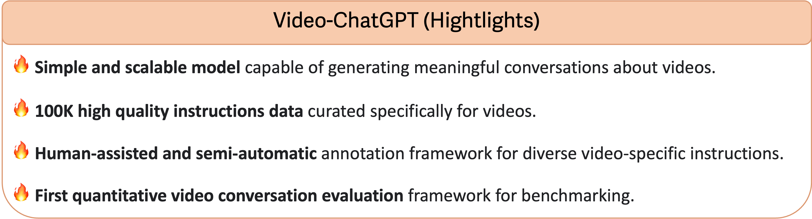
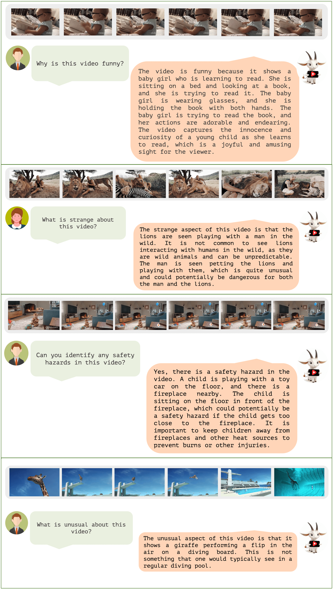
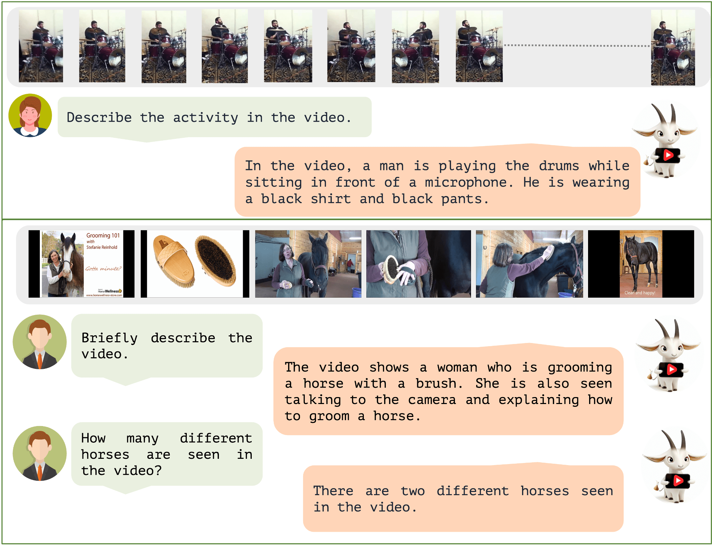
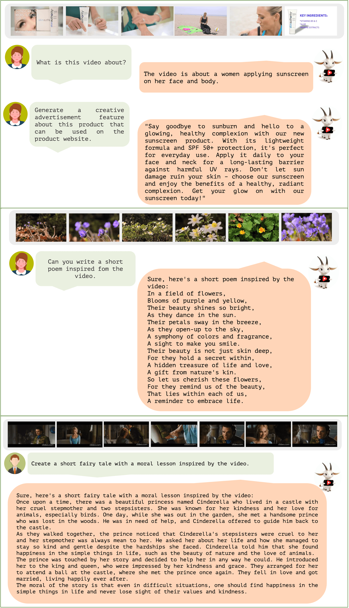
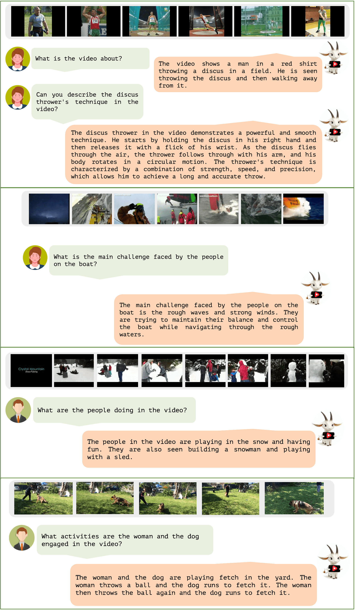
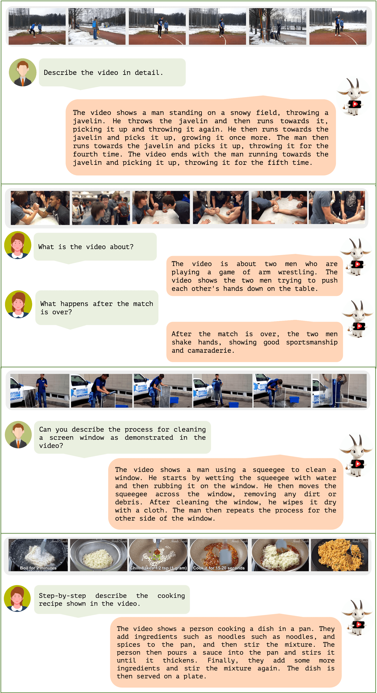
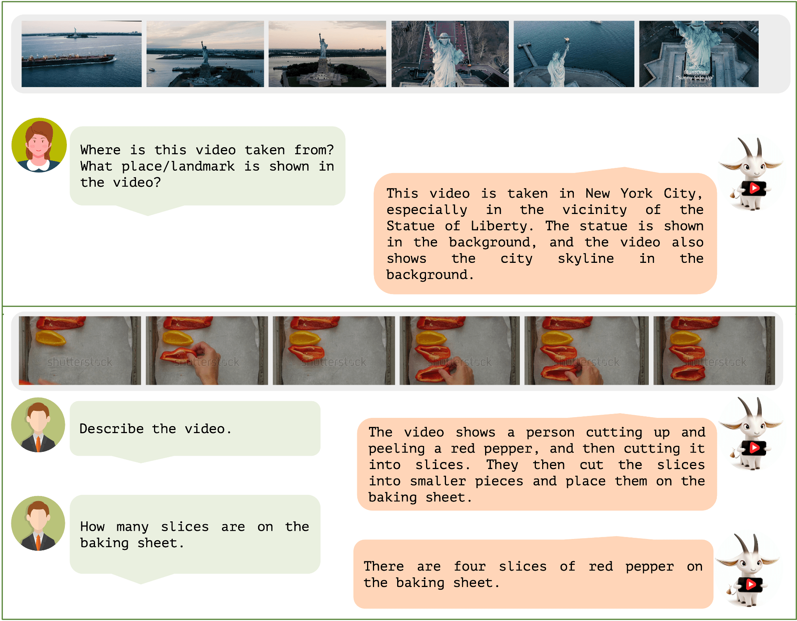

<div align="center">

# understandvideo

**A focused workspace for asking grounded questions about video.**

[](https://www.python.org/)
[](https://pytorch.org/)
[](LICENSE)
[](https://github.com/aaravkhanal)

<p align="center">
  <a href="#current-product">Current product</a> •
  <a href="#quickstart">Quickstart</a> •
  <a href="#architecture">Architecture</a> •
  <a href="#quality-checks">Quality checks</a> •
  <a href="docs/IMPLEMENTATION_PLAN.md">Implementation plan</a>
</p>

---

</div>

## Overview

**understandvideo-ai** is an end-to-end multimodal conversational AI system built for deep video comprehension. By harmonizing spatiotemporal visual feature representations with large autoregressive language models, **understandvideo-ai** enables detailed video question answering, temporal reasoning, dense video summarization, and multi-turn conversational interactions about complex video scenes.

<p align="center">
  
</p>

---

## Current product

This repository contains two related layers:

1. A modern React and FastAPI product workspace for uploading a video, navigating
   its timeline, and asking timestamp-linked questions.
2. The original Video-ChatGPT research, training, and evaluation code used for
   local model development and benchmark reproduction.

The included alpine film is a deterministic onboarding demo. Arbitrary uploads
are never answered with the demo's facts: they require either `OPENAI_API_KEY`
for sampled-frame vision inference or a future local inference worker. Without a
configured model, the app keeps the video playable and says that analysis is not
available instead of inventing an answer.

### Working today

- Premium responsive workspace with upload, playback, timeline navigation,
  overview, library search, and streamed answers.
- Public-link import for YouTube, Instagram, TikTok, Vimeo, X, Facebook,
  Twitch, Reddit, Dailymotion, and direct HTTPS video files. Platform imports
  preselect a browser-compatible MP4 within the configured size limit and
  verify that the finished file contains a decodable video track.
- Durable background link imports with real progress, cancellation, retry, and
  automatic UI recovery after a browser refresh.
- One-click repair for older failed link imports, preserving the library item
  and original URL while replacing unusable media and rebuilding its timeline.
- Durable local analysis jobs that detect strong visual cuts, fill sparse
  timelines with neutral reference frames, and persist real thumbnails/posters
  without inventing semantic labels.
- Inline library rename and deliberate two-step deletion with cascading cleanup
  of stored media, evidence frames, jobs, and conversation data.
- Durable named conversations per video, including new-thread creation, history
  reopening, automatic first-question titles, inline rename, and independent
  thread deletion.
- Free local timestamped speech transcription with speaker identification,
  automatic chapters, quote highlights, full-text search,
  click-to-seek results, retry state, and answer grounding.
- Supabase passwordless authentication with verified JWTs, account-isolated
  workspaces, and private Storage mirroring under user-scoped object keys.
- Pluggable demo, cloud-vision, and HTTP worker inference adapters, plus a
  separately runnable grounded-answer worker with storage-root and token checks.
- Timestamped workspace notes, Markdown/JSON/premium HTML report exports,
  expiring exact-moment links, downloadable 30-second clips, local review states,
  assignments/comments, and side-by-side structural video comparison.
- MP4, MOV, WebM, and AVI uploads with configurable size and hourly limits.
- Container-signature and decoder validation that rejects non-video files even
  when they use a supported filename or declared MIME type.
- Optional ClamAV scanning, per-video retention expiry and permanent deletion,
  durable account-scoped quotas, request IDs, timing metrics, and queue depth.
- A standalone persisted job worker, desktop/mobile Playwright coverage, and a
  CI workflow that runs build, unit, API, and browser checks.
- Workspace search across video titles, source links, transcripts, notes, and
  saved conversation messages, with user-managed searchable tags.
- SQLite metadata and conversation persistence, scoped by video and conversation.
- Free local Ollama vision inference over sampled frames, with optional OpenAI
  inference as a cloud alternative.
- Honest browser-only fallback and a zero-setup included demo.
- API regression tests for validation, limits, and conversation isolation.

### Known limitations

- Shot detection is visual-change based and intentionally falls back to neutral
  reference frames; semantic chapter names still require a connected vision model.
- Private, login-only, live, removed, DRM-protected, or extractor-incompatible
  online videos cannot be imported.
- Long online videos may be imported at a lower resolution so the combined
  video and audio remain within `MAX_UPLOAD_BYTES`.
- Local transcription runs on the machine and may be slower than real time on long
  videos. The first run downloads the selected speech and speaker models.
- The included queue is durable and separately runnable. Redis wake-ups and a
  distributed worker lease are used when `REDIS_URL` is configured, while the
  database remains the recovery source of truth. Multi-machine execution still
  requires the pending PostgreSQL metadata migration.
- ClamAV scanning is enforced only when `MALWARE_SCAN_MODE=required`. The supplied
  production stack runs decoding in a constrained worker container; stronger
  per-file sandboxing can be added with short-lived jobs on the deployment platform.
- Team invitations, semantic embeddings, and PostgreSQL `DATABASE_URL`
  integration remain deployment work. Signed webhooks automatically fan out
  video-ready, import-failed, and review-updated events with bounded retries.
  Local API-key lifecycle and signed webhook registration/test delivery are available.

The prioritized work is tracked in the
[implementation plan](docs/IMPLEMENTATION_PLAN.md) and
[product roadmap](docs/PLATFORM_ROADMAP.md).

---

## Key features

- **Spatiotemporal Visual Encoding**: Combines frame-level spatial feature extraction (CLIP ViT-L/14) with custom temporal pooling to model dynamic actions and continuous scenes.
- **Context-Aware Conversational QA**: Retains conversational history across multiple turns, enabling detailed exploration of visual events, objects, actions, and intent.
- **Zero-Shot Generalization**: Outperforms prior models on open benchmarks including MSVD-QA, MSRVTT-QA, TGIF-QA, and ActivityNet-QA without dataset-specific re-training.
- **Rigorous Evaluation Framework**: Includes built-in evaluation suites measuring correctness, detail orientation, contextual comprehension, temporal precision, and consistency.
- **Turnkey Interactive UI**: Powered by Gradio for quick local deployment and seamless video-upload-and-chat experimentation.
- **Scalable Data & Training Pipeline**: Includes data preprocessing, feature precomputation, instruction tuning, and model weight merging utilities.

---

## Architecture

<p align="center">
  
</p>

1. **Video Feature Extraction**: Input video frames are sampled and encoded into spatiotemporal tokens using a visual transformer encoder.
2. **Multimodal Projection**: A linear adapter layer bridges visual token dimensions into the language model embedding space.
3. **Autoregressive Decoding**: Visual prefix tokens condition the language model to generate fluent, contextually accurate conversational responses.

---

## Quickstart

The web product does not require a GPU or model weights for the included demo.
Use Node.js 20.19+ (or 22.12+) and Python 3.10+.

```bash
git clone https://github.com/Aaravkhanal/understandvideo-ai.git
cd understandvideo-ai

npm install
python -m venv .venv
source .venv/bin/activate
pip install -r server/requirements-dev.txt

npm run dev
```

The command opens the app at `http://localhost:4310` and starts its API
on `http://localhost:8787`. These dedicated ports avoid collisions with other
local projects. API documentation is available at `http://localhost:8787/docs`.

### Free local transcription and speaker identification

The app now defaults to local transcription: faster-whisper creates timestamped
text and pyannote Community-1 identifies speakers. No paid transcription API is
required.

1. Create a free Hugging Face account.
2. Accept the terms for `pyannote/speaker-diarization-community-1`.
3. Create a fine-grained read token with access to that gated model.
4. Activate this project's virtual environment and run `hf auth login` once.
5. Start the app normally. The first transcript downloads the local models and
   later runs reuse the on-device cache.

Use `LOCAL_WHISPER_MODEL=tiny` for the fastest/lower-accuracy option, `small`
for the default balance, or `medium` for better accuracy with more disk, memory,
and processing time. Set `LOCAL_SPEAKER_DIARIZATION=false` if you only need text.

## Web workspace

UnderstandVideo is a **video understanding and conversational Q&A platform**. It
does not generate or edit videos. Users provide an existing video, then ask
questions about its events, people, objects, setting, sequence, or meaning. Every
answer should remain grounded in the uploaded video and link back to supporting
timestamps whenever possible.

Use the **Try the 12 sec demo** action to explore the complete upload, analysis,
scene map, timestamp navigation, overview, and conversational flow with the
included cinematic sample. If the API is unavailable, the interface gracefully
continues in browser-only demo mode.

For real semantic Q&A over arbitrary uploaded videos, configure a vision model
before starting the app:

```bash
export OPENAI_API_KEY="your-key"
# Optional; defaults to gpt-4.1-mini
export OPENAI_VISION_MODEL="gpt-4.1-mini"
npm run dev
```

The server uniformly samples frames, attaches their timestamps, and sends those
frames with the question and recent conversation context. Without credentials,
the included sample remains fully interactive and other uploads show a clear
configuration message instead of returning invented answers.

Paste a public video page or direct HTTPS media URL into **Analyze a public
video link**. The API validates the destination, rejects local/private network
addresses, selects H.264 video and AAC audio that fit together under the same
size limit as uploads, verifies the result has a readable video track, stores
the media, and makes it available through the same library, player, timeline,
and chat workflow. If an older import is missing a playable track, use
**Repair web import** in the studio. The importer never uses browser cookies or
attempts to bypass access controls.

The server defaults to `INFERENCE_MODE=demo`. Its summary and SSE chat endpoints
are deliberately isolated behind `server/main.py`, providing a single integration
point for either the local `video_chatgpt` inference code or a hosted multimodal
provider. Uploaded media and the local SQLite database are ignored by Git.

See [Platform Roadmap](docs/PLATFORM_ROADMAP.md) for the prioritized path from
this local foundation to a production SaaS release.

### Configuration

Copy `.env.example` values into your shell or preferred environment manager.

| Variable | Default | Purpose |
| --- | --- | --- |
| `OPENAI_API_KEY` | unset | Enables sampled-frame cloud vision inference. |
| `OPENAI_VISION_MODEL` | `gpt-4.1-mini` | Vision-capable model used by the API. |
| `OPENAI_REQUEST_TIMEOUT` | `60` | Cloud inference timeout in seconds. |
| `OPENAI_TRANSCRIPTION_MODEL` | `whisper-1` | Model used for timestamped speech transcription. |
| `OPENAI_TRANSCRIPTION_TIMEOUT` | `180` | Transcription request timeout in seconds. |
| `OLLAMA_URL` | `http://127.0.0.1:11434` | Local Ollama service used for free visual question answering. |
| `OLLAMA_VISION_MODEL` | unset | Enables local vision inference; recommended value is `qwen3-vl:4b`. |
| `OLLAMA_FRAME_COUNT` | `6` | Number of timestamped frames sent to the local vision model. |
| `OLLAMA_REQUEST_TIMEOUT` | `180` | Local model timeout in seconds, including first-load time. |
| `TRANSCRIPTION_PROVIDER` | `local` | Use free `local` models or optional paid `openai` transcription. |
| `LOCAL_WHISPER_MODEL` | `small` | faster-whisper model size downloaded on first use. |
| `LOCAL_WHISPER_DEVICE` | `cpu` | Local transcription device. |
| `LOCAL_WHISPER_COMPUTE_TYPE` | `int8` | Efficient CPU computation mode. |
| `LOCAL_WHISPER_BEAM_SIZE` | `5` | Speech decoding search width. |
| `LOCAL_SPEAKER_DIARIZATION` | `true` | Add local speaker labels with pyannote. |
| `LOCAL_DIARIZATION_MODEL` | `pyannote/speaker-diarization-community-1` | Hugging Face speaker model. |
| `HUGGINGFACE_TOKEN` | cached login | Optional runtime token; prefer `hf auth login` for local use. |
| `LOCAL_ACCOUNT_ID` | `local-account` | Development account used before production authentication is connected. |
| `LOCAL_WORKSPACE_ID` | `local-workspace` | Workspace boundary applied to local API reads and writes. |
| `LOCAL_WORKSPACE_NAME` | `Personal workspace` | User-facing name for the local workspace record. |
| `VIDEO_WORKER_URL` | unset | Optional dedicated answer worker URL, such as `http://127.0.0.1:8788`. |
| `VIDEO_WORKER_TOKEN` | unset | Shared bearer token used between the API and answer worker. |
| `VIDEO_WORKER_TIMEOUT` | `90` | Answer-worker request timeout in seconds. |
| `WORKER_MEDIA_ROOT` | `server/uploads` | Filesystem root the dedicated worker is permitted to read. |
| `MAX_UPLOAD_BYTES` | `104857600` | Maximum accepted upload size. |
| `CHAT_REQUESTS_PER_HOUR` | `50` | Per-account chat request limit. |
| `UPLOADS_PER_HOUR` | `20` | Per-account upload/import request limit. |
| `MAX_REMOTE_DURATION_SECONDS` | `3600` | Longest permitted online video. |
| `REMOTE_IMPORT_TIMEOUT_SECONDS` | `180` | Maximum time allowed for link import. |
| `IMPORT_AUTO_RETRIES` | `2` | Automatic retries for temporary platform failures. |
| `MALWARE_SCAN_MODE` | `optional` | Use ClamAV when present, require it, or disable scanning. |
| `DEFAULT_RETENTION_DAYS` | `90` | Automatically delete new non-demo videos after 30, 90, or 365 days; `0` keeps them. |
| `UPLOAD_ROOT` | `server/uploads` | Local or mounted private-media working directory. |
| `DATABASE_PATH` | `server/understandvideo.db` | SQLite path used by local and single-host worker deployments. |
| `JOB_POLL_SECONDS` | `3` | Poll interval for the standalone durable job worker. |
| `REDIS_URL` | unset | Optional Redis wake-up and multi-worker lease; durable polling remains as fallback. |
| `REMOTE_MEDIA_HOSTS` | unset | Optional comma-separated platform hosts added by the server owner. |
| `CORS_ORIGINS` | local web URLs | Comma-separated browser origins allowed by the API. |
| `VITE_API_URL` | same origin | Optional direct API base URL for the frontend. |

### Hardened production worker

`compose.production.yml` provides a separately isolated job worker, a private
ClamAV service, and private persistent Redis coordination. The worker runs as a non-root user with all Linux capabilities
dropped, a read-only root filesystem, a no-execute temporary filesystem, a 2 CPU
limit, 4 GB memory limit, process/file-descriptor limits, and a 512 MB file-size
limit. Uploaded media and the SQLite transition database live on dedicated
volumes rather than inside the container layer.

1. Copy `.env.production.example` to `.env.production` on the production host.
2. Put real secrets in the hosting provider's secret manager and inject them as
   environment variables. Do not save production secret values in the file.
3. Run `npm run validate:production` in the configured deployment environment.
4. Start the services with `docker compose -f compose.production.yml up -d --build`.

The stack initializes volume ownership once, waits for ClamAV and Redis to become
healthy, and only then starts the non-root worker. Its lightweight image
includes local Whisper transcription but deliberately excludes pyannote/Torch;
run speaker diarization in the configured local model environment or a dedicated
CPU/GPU model service, rather than adding the full model stack to every import worker.

The selected identity direction is Supabase Auth because it can provide OIDC/JWT
identity alongside managed PostgreSQL. The hosted project and a private
`understandvideo-private` Storage bucket are provisioned. Apply
`migrations/002_supabase_storage_policies.sql` in the Supabase SQL editor; its
four policies restrict insert, read, update, and delete operations to object keys
whose first folder is the authenticated user's id. The bucket must remain
private, and production object names must follow
`<user-id>/<video-id>/<filename>` for those policies to allow access.

The React app now uses Supabase passwordless email sessions, sends the access
token with API requests, and the FastAPI service verifies its signature,
issuer, audience, and expiry against Supabase JWKS. Each authenticated user gets
an isolated personal workspace. Set `AUTH_MODE=required` outside automated
tests to reject anonymous private API requests.

The server-side Supabase Storage adapter mirrors each validated original into
`<user-id>/<video-id>/<filename>` while retaining a local working copy for
FFmpeg, transcription, and frame extraction. Deletion and retention cleanup
remove both copies. Playback uses five-minute Supabase signed URLs so browsers
can stream and seek without receiving the server key. PostgreSQL/Redis persistence
remains a separate production cutover; local processing still requires durable
worker-visible disk. Never expose `SUPABASE_SERVICE_ROLE_KEY` to Vite or commit
it—inject it into the API/worker through the deployment secret manager.

The browser reads public limits from `/api/config`, so UI labels and validation
stay aligned with server configuration.

For process isolation, start `npm run dev:worker`, set `VIDEO_WORKER_URL` on the
API process, and give both processes the same `VIDEO_WORKER_TOKEN`. The worker
accepts media only from `WORKER_MEDIA_ROOT`; production deployment should place
the API and worker on a private network with the same durable processing volume.

### API surface

| Method | Route | Purpose |
| --- | --- | --- |
| `GET` | `/api/health` | Health and inference mode. |
| `GET` | `/api/metrics` | Request timing, response counts, and queue depth. |
| `GET` | `/api/config` | Public upload and request limits. |
| `GET` | `/api/workspace` | Read the active local workspace and stored-video count. |
| `POST` | `/api/videos/upload` | Validate and persist a video. |
| `POST` | `/api/videos/import-url` | Import a supported public video link. |
| `GET/POST` | `/api/imports` | List or start durable background link imports. |
| `GET` | `/api/imports/{id}` | Read import progress and its completed video. |
| `POST` | `/api/imports/{id}/cancel` | Cancel a queued or active link import. |
| `POST` | `/api/imports/{id}/retry` | Retry a stopped link import. |
| `POST` | `/api/videos/{id}/reimport` | Repair a saved public-link import from its original URL. |
| `GET` | `/api/videos` | List or search persisted videos and their saved evidence. |
| `PATCH` | `/api/videos/{id}` | Rename a saved video. |
| `DELETE` | `/api/videos/{id}` | Delete media and all locally derived data. |
| `GET` | `/api/videos/{id}/content` | Stream stored media with byte-range support. |
| `GET` | `/api/videos/{id}/analysis` | Read durable processing state, shot-aware moments, and detection provenance. |
| `POST` | `/api/videos/{id}/analysis/retry` | Retry failed timeline extraction. |
| `GET` | `/api/videos/{id}/scenes/{scene_id}/thumbnail` | Read a persisted evidence thumbnail. |
| `GET` | `/api/videos/{id}/transcript` | Read or search timestamped transcript segments. |
| `POST/DELETE` | `/api/videos/{id}/transcript/highlights/{segment_id}` | Save or remove a quote highlight. |
| `POST` | `/api/videos/{id}/transcript/retry` | Retry failed or newly configured transcription. |
| `GET/POST` | `/api/videos/{id}/tags` | List or add searchable library tags. |
| `DELETE` | `/api/videos/{id}/tags/{tag}` | Remove a library tag. |
| `GET/POST` | `/api/videos/{id}/annotations` | List or create timestamped workspace notes. |
| `DELETE` | `/api/videos/{id}/annotations/{annotation_id}` | Remove a timestamped note. |
| `GET` | `/api/videos/{id}/export` | Download Markdown, JSON, or styled HTML reports. |
| `GET` | `/api/videos/{id}/clip` | Download a browser-compatible clip up to 120 seconds. |
| `PATCH` | `/api/videos/{id}/retention` | Set or clear automatic permanent deletion. |
| `GET/PUT` | `/api/videos/{id}/review` | Read or update review state and assignee. |
| `GET/POST` | `/api/videos/{id}/comments` | Read or add team-ready review comments. |
| `POST` | `/api/videos/{id}/shares` | Create an expiring exact-moment share link. |
| `GET` | `/api/shares/{token}` | Open public metadata for an unexpired shared moment. |
| `POST` | `/api/compare` | Compare two workspace videos and pair saved timeline moments. |
| `GET/POST` | `/api/developer/api-keys` | List metadata or create a key shown only once. |
| `DELETE` | `/api/developer/api-keys/{id}` | Revoke an API key. |
| `GET/POST` | `/api/developer/webhooks` | List or register signed HTTPS webhooks. |
| `POST` | `/api/developer/webhooks/{id}/test` | Send a signed test event. |
| `GET` | `/api/videos/{id}/summary` | Demo overview or truthful analysis status. |
| `POST` | `/api/chat/stream` | Stream a conversation-scoped answer over SSE. |
| `GET/POST` | `/api/videos/{id}/conversations` | List or create durable video conversations. |
| `PATCH` | `/api/videos/{id}/conversations/{conversation_id}` | Rename a conversation. |
| `DELETE` | `/api/videos/{id}/conversations/{conversation_id}` | Delete one conversation and its messages. |
| `GET` | `/api/videos/{id}/messages` | Read message history, optionally by conversation. |

## Quality checks

Install development dependencies and run the complete check:

```bash
pip install -r server/requirements-dev.txt
npm run check
```

`npm run check` builds the production frontend, compiles the Python sources, and
runs API regression tests. The browser interface is also manually verified at
the local preview URL after visual changes.

### Legacy Gradio demo

Launch the local interactive Gradio dashboard:

```bash
python video_chatgpt/demo/video_demo.py \
    --model-name <path-to-LLaVA-model-weights> \
    --projection_path <path-to-model-checkpoint>
```

Once running, navigate to `http://localhost:7860` in your web browser. Upload an MP4 video clip, type questions in natural language, and inspect generated video descriptions in real-time.

For detailed offline preparation, see [Offline Demo Guide](docs/offline_demo.md).

---

## 📊 Benchmarks

### 1. Zero-Shot Video Question Answering

| Model | MSVD-QA Acc | MSVD-QA Score | MSRVTT-QA Acc | MSRVTT-QA Score | TGIF-QA Acc | TGIF-QA Score | ActivityNet-QA Acc | ActivityNet-QA Score |
| :--- | :---: | :---: | :---: | :---: | :---: | :---: | :---: | :---: |
| FrozenBiLM | 32.2 | -- | 16.8 | -- | 41.0 | -- | 24.7 | -- |
| Video Chat | 56.3 | 2.8 | 45.0 | 2.5 | 34.4 | 2.3 | 26.5 | 2.2 |
| LLaMA Adapter | 54.9 | 3.1 | 43.8 | 2.7 | - | - | 34.2 | 2.7 |
| Video LLaMA | 51.6 | 2.5 | 29.6 | 1.8 | - | - | 12.4 | 1.1 |
| **understandvideo-ai** | **64.9** | **3.3** | **49.3** | **2.8** | **51.4** | **3.0** | **35.2** | **2.7** |

---

### 2. Generative Performance Benchmarking

| Metric Aspect | Video Chat | LLaMA Adapter | Video LLaMA | **understandvideo-ai** |
| :--- | :---: | :---: | :---: | :---: |
| **Correctness of Information** | 2.23 | 2.03 | 1.96 | **2.40** |
| **Detail Orientation** | 2.50 | 2.32 | 2.18 | **2.52** |
| **Contextual Understanding** | 2.53 | 2.30 | 2.16 | **2.62** |
| **Temporal Understanding** | 1.94 | **1.98** | 1.82 | **1.98** |
| **Consistency** | 2.24 | 2.15 | 1.79 | **2.37** |

---

## 🖼️ Qualitative Capabilities

<details open>
<summary><b>Click to expand qualitative demonstration samples</b></summary>
<br>

### Video Reasoning & Action Recognition



### Creative Synthesis & Question Answering



### Temporal & Spatial Scene Comprehension



</details>

---

## 🛠️ Training & Fine-Tuning

The legacy research stack pins PyTorch, Transformers, Gradio, and Pydantic
versions that intentionally differ from the modern FastAPI environment. Install
it in a separate Conda environment; do not combine both requirement files in one
environment.

```bash
conda create -n understandvideo-model python=3.10 -y
conda activate understandvideo-model
pip install -r requirements.txt
export PYTHONPATH="./:$PYTHONPATH"
```

FlashAttention v1 is optional and should only be installed when reproducing the
original CUDA training setup.

To train or fine-tune **understandvideo-ai** across 8 GPUs using PyTorch Distributed / Torchrun:

```bash
torchrun --nproc_per_node=8 --master_port 29001 video_chatgpt/train/train_mem.py \
    --model_name_or_path <path-to-base-model> \
    --version v1 \
    --data_path <path-to-training-instruction-json> \
    --video_folder <path-to-spatio-temporal-features> \
    --tune_mm_mlp_adapter True \
    --mm_use_vid_start_end \
    --bf16 True \
    --output_dir ./checkpoints \
    --num_train_epochs 3 \
    --per_device_train_batch_size 4 \
    --per_device_eval_batch_size 4 \
    --gradient_accumulation_steps 1 \
    --evaluation_strategy "no" \
    --save_strategy "steps" \
    --save_steps 3000 \
    --learning_rate 2e-5 \
    --warmup_ratio 0.03 \
    --lr_scheduler_type "cosine" \
    --logging_steps 100 \
    --model_max_length 2048 \
    --gradient_checkpointing True \
    --lazy_preprocess True
```

For data formatting and custom video annotation generation, refer to:
- [Training Guide](docs/train_video_chatgpt.md)
- [Dataset Guide](data/README.md)

---

## 📈 Evaluation Suites

Run quantitative zero-shot evaluations:

```bash
# General multi-criteria benchmark
bash quantitative_evaluation/evaluate_benchmark.sh

# ActivityNet-QA benchmark
python quantitative_evaluation/evaluate_activitynet_qa.py \
    --pred_path <path-to-predictions.json> \
    --output_dir ./eval_results \
    --output_json results.json \
    --api_key <your-openai-api-key>
```

For more documentation, see [Quantitative Evaluation Guide](quantitative_evaluation/README.md).

---

## 📂 Project Structure

```text
understandvideo-ai/
├── src/                          # React product workspace
├── public/demo/                  # Included onboarding film and scene stills
├── server/                       # FastAPI upload, persistence, and inference API
│   └── tests/                    # API regression tests
├── data/                         # Instruction data generation & tooling
├── docs/                         # Plans, guides, and sample visual assets
├── quantitative_evaluation/      # Benchmarking scripts and evaluation tools
├── scripts/                      # Delta weight application and feature extraction
├── video_chatgpt/                # Core modeling, conversation engine & demo UI
│   ├── demo/                     # Gradio interface & web server components
│   ├── eval/                     # Model inference runners
│   ├── model/                    # PyTorch model definitions & projections
│   └── train/                    # Distributed fine-tuning scripts
├── package.json                  # Web scripts and dependencies
├── requirements.txt              # Legacy model dependencies
├── .env.example                  # Supported runtime configuration
├── LICENSE                       # MIT License
└── README.md                     # Project documentation
```

---

## 👤 Author

**Aarav Khanal**
- GitHub: [@aaravkhanal](https://github.com/aaravkhanal)
- Issues & Suggestions: [Open an Issue](https://github.com/Aaravkhanal/understandvideo-ai/issues)

---

## 📜 License

This project is open-source and released under the [MIT License](LICENSE).
